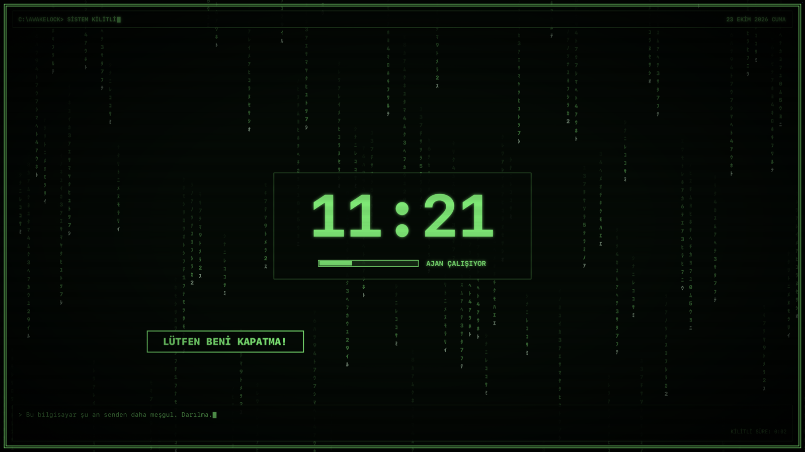

# AwakeLock

A tiny lock screen that keeps your computer awake, so long-running work (AI agent sessions in your editor, SSH, builds) keeps going behind it. Retro CRT look: falling glyphs, a bouncing "please don't close me" plea, a typewriter joke line. UI text is Turkish.



Covers every connected monitor. Unlocks with your account password. Sleep is blocked only while locked.

## macOS (native, Swift)

```sh
cd macos && ./build.sh
```

Builds with `swiftc` (Command Line Tools are enough), installs to `~/Applications/AwakeLock.app` and starts it in the menu bar.

- `⌃⌥⌘L` or the menu bar item locks
- Unlock with your Mac password (or Touch ID if enrolled)
- Kiosk mode while locked: no Dock, menu bar, Cmd+Tab or Force Quit
- Animations run on the GPU via Core Animation
- "Oturum açılınca başlat" in the menu starts it at login

## Windows and Linux (Python)

Single file, standard library only: [`windows-linux/awakelock.py`](windows-linux/awakelock.py). Python 3.8+ with tkinter. Running it locks immediately, so bind it to a keyboard shortcut.

**Windows**
1. Install Python from python.org (tkinter is included).
2. Create a shortcut to `pythonw.exe C:\path\to\awakelock.py`, open its Properties and set a *Shortcut key* (e.g. `Ctrl+Alt+L`).
3. Unlock with your Windows account password (a PIN does not work).
   Win key, Alt+Tab, Alt+Esc, Alt+F4 and Ctrl+Esc are blocked while locked. Ctrl+Alt+Del cannot be blocked.

**Linux (X11)**
1. `sudo apt install python3-tk x11-xserver-utils` (or your distro's equivalent). `systemd-inhibit` is used to block sleep.
2. Add a custom keyboard shortcut in your desktop settings that runs `python3 /path/to/awakelock.py`.
3. Unlock with your login password (checked through PAM).
   Keyboard and mouse are grabbed while locked. On Wayland sessions the grab and multi-monitor placement depend on the compositor and may not work.

## Caveats

This is not the operating system's lock. If the app is killed or crashes, the overlay disappears; use the system lock (`⌃⌘Q`, `Win+L`, your desktop's lock) when you need real security. On a laptop keep the lid open, closing it still sleeps the machine.

## License

MIT
